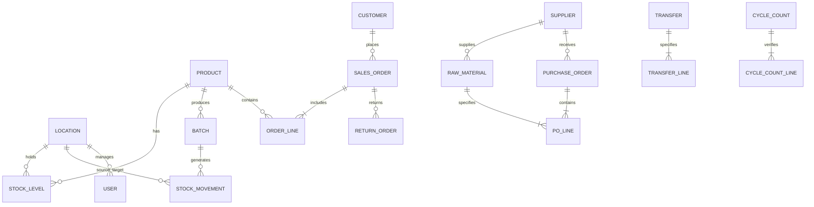

# 🗄️ Relational Database Schema & Data Models

This specification serves as the architectural blueprint for the companion Node.js database layer (SQLite / PostgreSQL / TiDB Cloud) located in `E:\dashborad clone\node`.

---

## 1. Entity-Relationship (ER) Diagram



---

## 2. Table Specifications & DDL

### 2.1 `products`
```sql
CREATE TABLE products (
    id VARCHAR(32) PRIMARY KEY,
    name VARCHAR(255) NOT NULL,
    size VARCHAR(64) NOT NULL,
    category VARCHAR(64) NOT NULL CHECK(category IN ('Cleanse', 'Treat', 'Moisturise', 'Protect', 'Body')),
    price DECIMAL(10, 2) NOT NULL,
    cost DECIMAL(10, 2) NOT NULL,
    reorder_threshold INT NOT NULL DEFAULT 50,
    is_active BOOLEAN NOT NULL DEFAULT TRUE,
    photo_url VARCHAR(255),
    created_at TIMESTAMP DEFAULT CURRENT_TIMESTAMP,
    updated_at TIMESTAMP DEFAULT CURRENT_TIMESTAMP
);
CREATE INDEX idx_products_category ON products(category);
CREATE INDEX idx_products_active ON products(is_active);
```

### 2.2 `stock_levels` (Normalized Location Balances)
```sql
CREATE TABLE stock_levels (
    product_id VARCHAR(32) NOT NULL REFERENCES products(id) ON DELETE CASCADE,
    location_id VARCHAR(32) NOT NULL REFERENCES locations(id) ON DELETE RESTRICT,
    quantity INT NOT NULL DEFAULT 0 CHECK(quantity >= 0),
    PRIMARY KEY (product_id, location_id)
);
CREATE INDEX idx_stock_levels_loc ON stock_levels(location_id);
```

### 2.3 `batches` (Production Lots)
```sql
CREATE TABLE batches (
    id VARCHAR(32) PRIMARY KEY,
    lot_number VARCHAR(64) NOT NULL UNIQUE,
    product_id VARCHAR(32) NOT NULL REFERENCES products(id) ON DELETE RESTRICT,
    status VARCHAR(32) NOT NULL CHECK(status IN ('quarantine', 'released', 'hold', 'expired')),
    initial_qty INT NOT NULL CHECK(initial_qty > 0),
    current_qty INT NOT NULL CHECK(current_qty >= 0),
    mfg_date TIMESTAMP NOT NULL,
    released_date TIMESTAMP,
    expiry_date TIMESTAMP NOT NULL,
    notes TEXT,
    created_at TIMESTAMP DEFAULT CURRENT_TIMESTAMP
);
CREATE INDEX idx_batches_product ON batches(product_id);
CREATE INDEX idx_batches_status ON batches(status);
CREATE INDEX idx_batches_expiry ON batches(expiry_date);
```

### 2.4 `sales_orders`
```sql
CREATE TABLE sales_orders (
    id VARCHAR(32) PRIMARY KEY,
    order_number VARCHAR(32) NOT NULL UNIQUE,
    customer_id VARCHAR(32) NOT NULL REFERENCES customers(id),
    channel VARCHAR(32) NOT NULL CHECK(channel IN ('wholesale', 'online', 'studio')),
    status VARCHAR(32) NOT NULL CHECK(status IN ('new', 'picking', 'packed', 'shipped', 'delivered', 'cancelled')),
    ship_by TIMESTAMP NOT NULL,
    location_id VARCHAR(32) NOT NULL REFERENCES locations(id),
    carrier VARCHAR(64) NOT NULL,
    is_paid BOOLEAN NOT NULL DEFAULT FALSE,
    tracking_number VARCHAR(128),
    created_at TIMESTAMP DEFAULT CURRENT_TIMESTAMP,
    updated_at TIMESTAMP DEFAULT CURRENT_TIMESTAMP
);
CREATE INDEX idx_orders_status ON sales_orders(status);
CREATE INDEX idx_orders_customer ON sales_orders(customer_id);
CREATE INDEX idx_orders_created ON sales_orders(created_at);
```

### 2.5 `order_lines`
```sql
CREATE TABLE order_lines (
    id VARCHAR(32) PRIMARY KEY,
    order_id VARCHAR(32) NOT NULL REFERENCES sales_orders(id) ON DELETE CASCADE,
    product_id VARCHAR(32) NOT NULL REFERENCES products(id),
    quantity INT NOT NULL CHECK(quantity > 0),
    unit_price DECIMAL(10, 2) NOT NULL
);
CREATE INDEX idx_order_lines_order ON order_lines(order_id);
```

### 2.6 `stock_movements` (Immutable Audit Ledger)
```sql
CREATE TABLE stock_movements (
    id VARCHAR(32) PRIMARY KEY,
    item_id VARCHAR(32) NOT NULL,
    from_location VARCHAR(32) REFERENCES locations(id),
    to_location VARCHAR(32) REFERENCES locations(id),
    quantity INT NOT NULL,
    reason VARCHAR(32) NOT NULL CHECK(reason IN ('sale', 'production', 'transfer', 'adjustment', 'return')),
    reference_id VARCHAR(64),
    performed_by VARCHAR(32) REFERENCES users(id),
    created_at TIMESTAMP DEFAULT CURRENT_TIMESTAMP
);
CREATE INDEX idx_movements_item ON stock_movements(item_id);
CREATE INDEX idx_movements_created ON stock_movements(created_at);
```

### 2.7 `raw_materials` & `purchase_orders`
```sql
CREATE TABLE raw_materials (
    id VARCHAR(32) PRIMARY KEY,
    sku VARCHAR(64) NOT NULL UNIQUE,
    name VARCHAR(255) NOT NULL,
    unit VARCHAR(32) NOT NULL,
    supplier_id VARCHAR(32) NOT NULL REFERENCES suppliers(id),
    unit_cost DECIMAL(10, 2) NOT NULL,
    on_hand INT NOT NULL DEFAULT 0,
    reorder_threshold INT NOT NULL DEFAULT 20
);

CREATE TABLE purchase_orders (
    id VARCHAR(32) PRIMARY KEY,
    po_number VARCHAR(32) NOT NULL UNIQUE,
    supplier_id VARCHAR(32) NOT NULL REFERENCES suppliers(id),
    status VARCHAR(32) NOT NULL CHECK(status IN ('draft', 'sent', 'partial', 'received', 'cancelled')),
    eta TIMESTAMP,
    received_at TIMESTAMP,
    created_at TIMESTAMP DEFAULT CURRENT_TIMESTAMP
);
```

---

## 3. Concurrency & Transaction Rules

1. **Atomic Order Allocation**: When an order shifts to `picking`, inventory must be reserved in a transaction:
   ```sql
   BEGIN TRANSACTION;
   SELECT quantity FROM stock_levels WHERE product_id = ? AND location_id = ? FOR UPDATE;
   -- Validate quantity >= requested
   UPDATE stock_levels SET quantity = quantity - ? WHERE product_id = ? AND location_id = ?;
   INSERT INTO stock_movements (...) VALUES (...);
   COMMIT;
   ```
2. **QA Release Stock Addition**: When a batch changes status to `released`, its units are automatically injected into `stock_levels` for the lab location.
3. **Optimistic Locking**: Use `updated_at` timestamps on `sales_orders` and `batches` to detect concurrent edits between multiple warehouse pickers.
